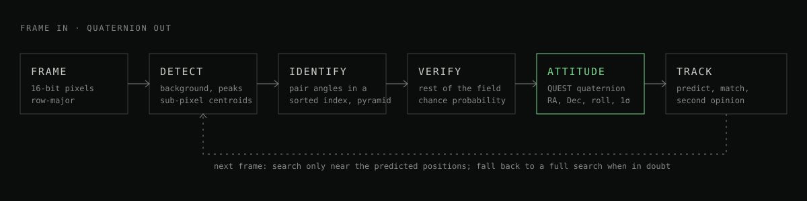
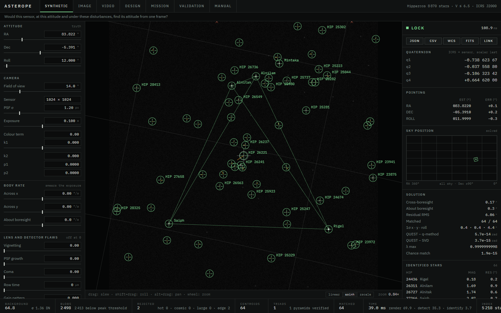
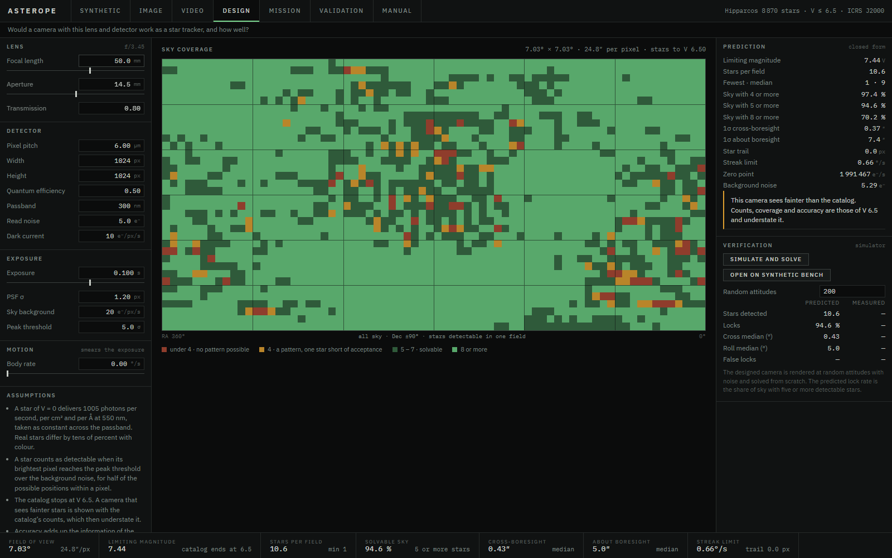
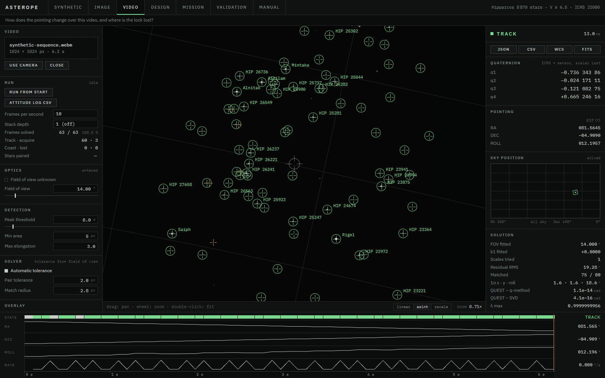
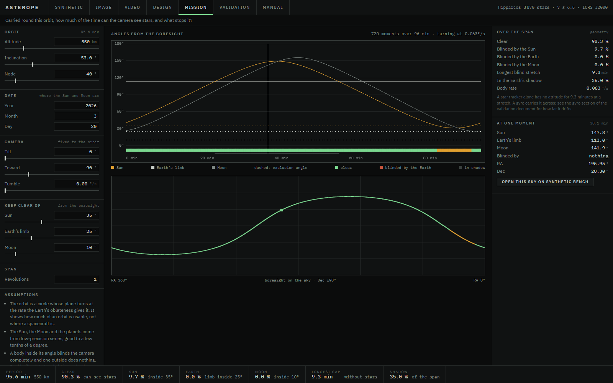
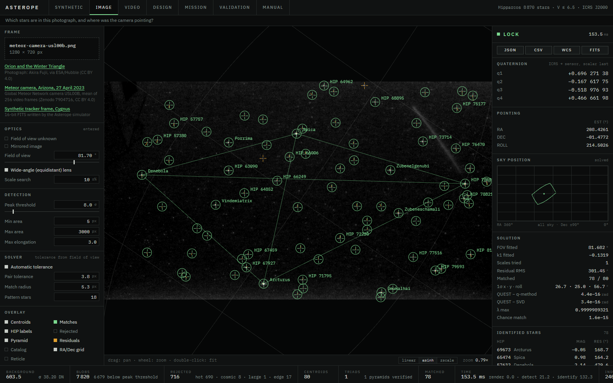
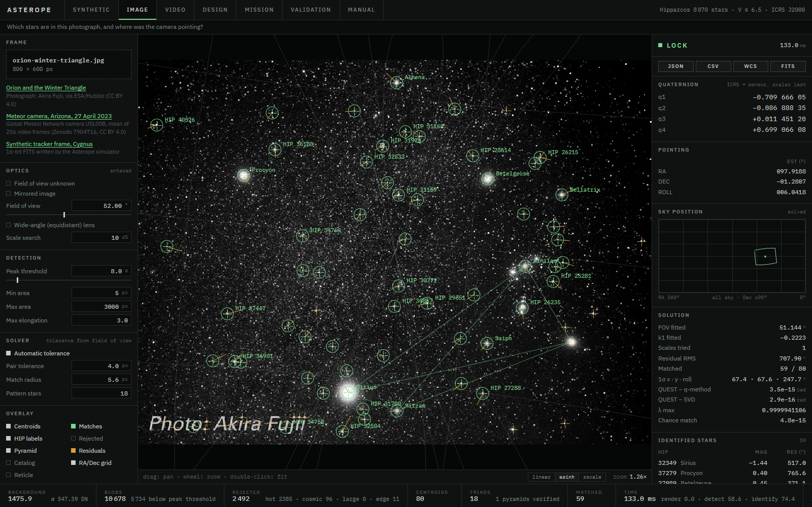
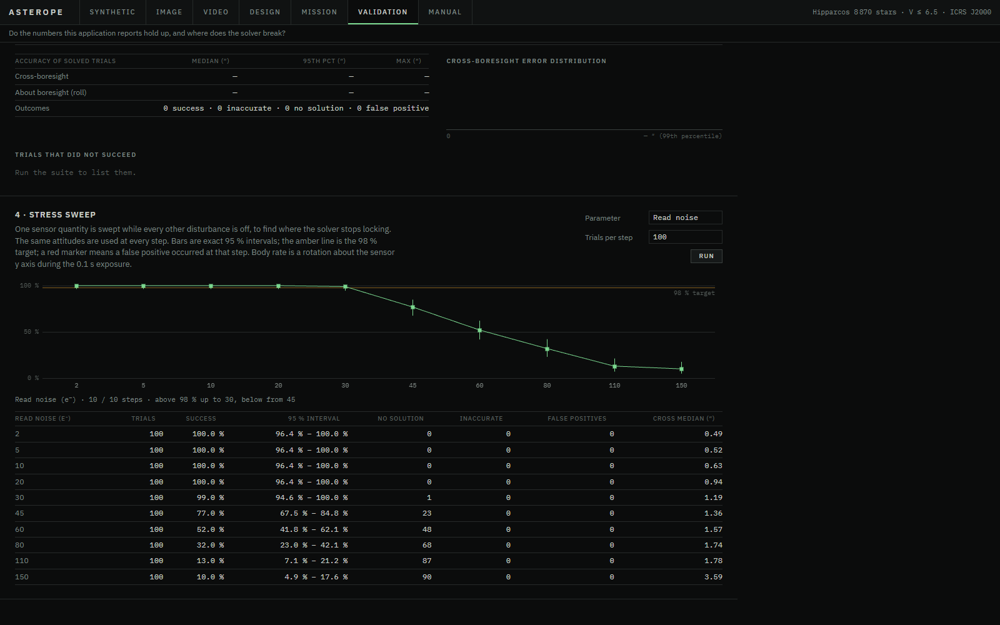

# Asterope

https://github.com/user-attachments/assets/c93dc9be-81cc-4d22-babc-774a1738a020

*Ninety seconds, with sound. It opens on a real frame from a meteor camera,
solved without being told the field of view. The same film as a file:
[docs/media/asterope-film.mp4](docs/media/asterope-film.mp4).*

Asterope finds which way a camera is pointing by recognizing the stars in its
image. It is the software of a star tracker, the instrument a satellite uses
to know its orientation, together with a workbench for trying that software,
stressing it, and choosing a camera for it before one is bought.

The name is that of a star in the Pleiades (HIP 17579, V 5.8), one of the
8 870 in the catalog.

It is written for people building small satellites who need an attitude
sensor they can read, measure and change, and for anyone who wants to see
how one works.

**Four ways to use it**

| | For | Start here |
|---|---|---|
| **Library** | Flight or ground software. Rust, `no_std`, or C through a header. Frame in, quaternion out. | `docs/integration.md` |
| **Command line** | Solving photographs and frame sequences, calibrating a lens, building the onboard index, walking an orbit. | `asterope help` |
| **Python** | Notebooks and ground tools. NumPy arrays in, quaternions out. | `docs/python.md` |
| **Workbench** | Seeing it work in a browser: simulate a sensor, drop in a photograph or a video, design a camera, lay out an orbit. | [spaceengineerss.github.io/asterope](https://spaceengineerss.github.io/asterope/), or `npm run dev` in `web/` |

The core is Rust; the workbench is the same code compiled to WebAssembly
under a TypeScript and React interface. Nothing leaves the browser.





## The benches

- **Synthetic.** *Would this sensor, at this attitude and under these
  disturbances, find its attitude from one frame?* A pinhole camera with
  Brown-Conrady distortion, a pixel-integrated PSF, shot and read noise, hot
  pixels, cosmic rays, stray light and motion blur, looking at the real sky.
  Vignetting, gain and dark patterns, column noise, coma, a rolling shutter
  and blooming can be switched on one at a time. Drag to slew and watch
  where the lock is lost. A sequence mode shows the
  tracker acquire and follow, and records the frames as video.
- **Image.** *Which stars are in this photograph, and where was the camera
  pointing?* PNG, JPEG or FITS; the field of view can be entered, read from
  EXIF, or searched.
- **Video.** *How does the pointing change over this video, and where is the
  lock lost?* A file or a live camera, solved frame by frame with the
  tracker; a timeline of right ascension, declination, roll and rate; the
  path on the sky; frame stacking for footage that shows few stars.
- **Design.** *Would a camera with this lens and detector work as a star
  tracker, and how well?* Limiting magnitude, stars per field, a map of the
  sky it can and cannot solve, expected accuracy and the slew rate at which
  stars trail, from focal length, aperture, pixel size and noise. One button
  simulates the design and puts the measurement next to the prediction.
- **Mission.** *Over an orbit, how much of the time can this camera see
  stars, and what blinds it the rest?* A circular orbit, a mounting and
  exclusion angles for the Sun, the Earth's limb and the Moon; the angles
  over time, the path on the sky, the longest stretch without stars. Any
  moment opens on the Synthetic bench.
- **Validation.** *Do the numbers this application reports hold up, and
  where does the solver break?* Three test suites and stress sweeps, in the
  browser and on the command line with identical results.
- **Manual.** What a star tracker does, how each step works, the terms.











## What it computes

| Stage | Method |
|---|---|
| Detection | Local background mesh, run-based connected components, hot-pixel and cosmic-ray rejection |
| Centroid | Intensity-weighted center of gravity under an iterated Gaussian window |
| Star identification | k-vector range search on angular separations, Pyramid pattern search with a fourth confirming star, whole-field verification with a multiple-testing correction |
| Attitude | QUEST, Davenport q-method and an SVD solution of Wahba's problem; stars weighted by centroid accuracy, with robust weights against spoiled centroids |
| Tracking | Prediction from the measured body rate, windowed association, a pattern search as second opinion on doubtful frames |
| Gyro fusion | Multiplicative extended Kalman filter, six states: attitude error and gyro bias; it carries the attitude through frames without stars |
| Trailed stars | Centroid along the trail, referred to the middle of the exposure; rolling-shutter correction from a known rate |
| Video | Catalog-free registration of consecutive frames, resampling and averaging |
| Camera model | Pinhole or equidistant lens with Brown-Conrady distortion; both are searched when the lens is unknown |
| Calibration | Focal length, principal point and distortion from several solved frames, with uncertainties |
| Corrections | Proper motion, stellar aberration, atmospheric refraction for cameras on the ground |
| Sky and orbit | Low-precision positions of the Sun, the Moon and the planets; a circular orbit with nodal regression, eclipse and exclusion angles |

`docs/algorithms.md` describes each step and its references.
`docs/error-budget.md` lists what moves a reported attitude, term by term.
`docs/conventions.md` fixes frames, quaternion order and signs.

## Results

Every figure below is produced by a test in this repository;
`docs/validation.md` says which, and how. Default sensor: 1024 x 1024,
14 degree field, PSF sigma 1.2 px, 5 e- read noise.

| | Result |
|---|---|
| Sub-pixel centroid | 0.0004-0.006 px without noise; 0.041 px at peak SNR 60 |
| QUEST and q-method against an SVD solution | within 8e-13 and 9e-12 rad over 10 000 fields |
| Lost in space, 10 000 random attitudes with disturbances | 10 000 solved (95 % interval 99.96-100 %), 0 false positives (upper bound 0.037 %); median error 0.53″ across the boresight, 3.1″ about it |
| Field-of-view sweep, 10 000 trials each | 100 % at 12, 16, 20 and 25 degrees; 98.4 % and one false positive at 8 degrees, where the catalog runs out |
| Real meteor cameras, 88 degree lens, 23 cameras (Global Meteor Network) | 23 of 23 solved without a field of view; against the network's own astrometry at measured pixels, median difference 0.18 degrees, under 0.5 on 17 of 21 cameras |
| Real meteor camera, 54 degree lens | 8 of 9 frames (one overcast); center declination 8.51 against 8.52 degrees, scale 24.0 against 24.03 px per degree |
| Real star tracker test frames, 11 degree field (ESA) | 8 of 8; the same field of view to 0.02 degrees on every frame |
| Onboard index, 558 kB, searched in place | 99.62 % (interval 99.48-99.73 %), 0 false positives |
| Flash on a Cortex-M7 | 64 kB code, 702 kB index and catalog |
| Heap per 1024 x 1024 frame | 668 kB peak, about 25 allocations |
| Aberration at 34 km/s | 17.4″ error uncorrected, 0.8″ corrected |
| Stacking 8 frames, 6 ms exposure | locks on 12 of 24 sequences against 4 of 24 single frames |
| Design prediction against the simulator, five cameras | star counts within 8 %, lock rate within 6 points, accuracy across the boresight within 35 % |
| Stars weighted by centroid accuracy, 3 000 disturbed frames | median error 0.53″ against 0.80″ unweighted, 95 % within 1.22″ against 2.01″; the same frames lock |
| 4 degree field | 99.7 % with the V 8 catalog against 27.0 % with V 6.5 |
| 2 degree field, Tycho-2 to V 9.5 | 99.7 %, 0 false |
| Detector flaws all at once (vignetting, gain and dark patterns, column noise, coma, nonlinearity, blooming) | 100 % of 300, median error 1.13″ against 0.56″ ideal |
| Rolling shutter, 60 µs a row, turning at 1 degree a second | median 37″ left in, 1.25″ undone with the known rate |
| Planets and the Moon in the field, 483 images to V -4.7 | 100 % solved, 0 false, accuracy unchanged (0.52″ against 0.50″) |
| Sun, Moon and planet positions against ERFA | within 0.31 degrees (Moon), 0.19 (Saturn), 0.01 (Sun) |
| Gyro filter consistency | NEES 6.00 for 6 states, NIS 2.99 for 3 |
| Gyro beside the camera, a third of the frames without stars | attitude on 300 of 300 frames against 200; error across the boresight 1.3″ RMS against 11.8″ |
| Trailed stars kept, 2 degrees a second at 0.1 s | 98.7 % lock against 1.3 % when trails are rejected |
| A revolution at 550 km, looking away from the Earth | stars 82.8 % of the time, attitude 97.9 % with the gyro; longest gap 640 s |
| A million fields without a sky, and a million with one | no attitude for the first; none over 0.1 degrees off for the second (upper bound 3.7e-6 each) |
| The flight path on an emulated Cortex-M7 (QEMU) | the same quaternion bits as the desktop; 113 million instructions, 1.0 MB of arena and 9.8 kB of stack a frame |
| Frames built to cost the most | a failed search takes 3 times a successful one and no more memory; detection memory is bounded by a setting (`docs/validation.md`, section 24) |
| Bits flipped in the index and catalog files, 40 896 single flips | every one refused by a checksum |
| Against tetra3 on the ESA frames | 8 of 8 agree, median difference 2.4″ |

Where it breaks, one quantity at a time (above 98 % success up to the first
value, clearly below at the second): read noise 30 / 45 e-, stray light
10 000 / 30 000 e-/px/s, hot pixels 0.3 / 1 %, cosmic rays 20 / 50 per frame,
PSF sigma 3 / 4 px, body rate 1 / 1.5 deg/s at a 0.1 s exposure.



Three photographs from the web (8, 33 and 52 degree fields) lock with the correct
stars, with or without a field of view, in the browser and on the command
line; a narrow nebula field and a 2 degree field do not.

## Limits

- **Nothing here has flown or run on hardware.** The real frames it has
  solved come from ground cameras; the simulator is a model of a detector;
  the embedded build runs on an emulated Cortex-M7, which gives the same
  bits and an instruction count, and no timing.
- The default catalog stops at V 6.5 and serves fields down to about 8
  degrees. `data/hip80.astc` (V 8) takes that to about 4 degrees, and a
  Tycho-2 catalog built locally to about 2, each on a sensor that reaches
  those stars. The 2 degree index is about 140 MB.
- The real frames are stills and 10 second means of video. No raw
  real-time video of the night sky has been solved; two archive
  time-lapses and one twilight frame did not lock (`docs/validation.md`).
  Phone footage shows few stars per frame, and stacking helps only when
  three are visible in single frames.
- On a wide lens the fitted model is good to a few pixels on most cameras
  and off by one to two degrees toward the frame edge on some.
- Solving without a field of view takes seconds to a minute, and tens of
  seconds to give up on a frame that cannot be solved.
- Bright nebulosity dominating a narrow field defeats the pattern search.
- Trailed stars are rejected unless `trails` is set. With it, at a 0.1 s
  exposure, 98.7 % of frames lock at 2 degrees a second and 62 % at 4.
- Under extreme degradation (2 % hot pixels, PSF sigma above 4 px) occasional
  false locks occur; the false-lock bounds are for the baseline only.
- Stray light is a phenomenological gradient, not a ray-traced baffle model,
  and a body inside its exclusion angle blinds the camera completely.
- The orbit is a circle with nodal regression, and the Sun, Moon and
  planets are good to a few tenths of a degree: enough to say how much of an
  orbit is usable, not to plan one.
- The gyro filter was tested against the simulator's gyro model only.
- The Design bench rests on a textbook photometric constant that was not
  checked against an instrument.

## Build

Requirements: Rust 1.88 or later with the `wasm32-unknown-unknown` target,
[`wasm-pack`](https://rustwasm.github.io/wasm-pack/), and Node 22.

```
cd web
npm install
npm run wasm     # builds crates/asterope-wasm into web/src/wasm
npm run dev      # http://localhost:5173
```

The command-line tool:

```
cargo build --release -p asterope-cli          # target/release/asterope

asterope solve photo.jpg                       # field of view searched
asterope solve frame.fits --fov 14
asterope simulate --out frame.fits --ra 83.8 --dec -5.4 --fov 14
asterope calibrate frames/ --fov 40 --out camera.toml
asterope build-index data/hip65.astc cam.asti --fov 14 --catalog-out cam.astc
asterope replay frames/ --camera camera.toml --out attitude.csv
asterope orbit --altitude 550 --inclination 97.6
asterope validate --trials 10000 --sweep --stress 300 --profiles 10000
```

Checks:

```
cargo test --workspace --release
cargo clippy --workspace --all-targets -- -D warnings
cargo build --release -p asterope-core --target thumbv7em-none-eabihf
cargo test --release -p asterope-core --test budget -- --nocapture
cargo test --release -p asterope-core --test false_locks -- --ignored --nocapture

cd examples/emulated && cargo build --release && node run.mjs   # needs qemu-system-arm

cd crates/asterope-py && maturin develop --release && pytest

cd web
npm run typecheck && npm run lint && npm test && npm run build
npx playwright install chromium firefox webkit && npm run e2e
npx playwright test --project chromium           # one engine; PW_CHANNEL=msedge uses an installed Edge
```

## Layout

```
crates/asterope-core   no_std core: math, catalog, camera, detection, pair
                      index, identification, attitude, tracking, gyro
                      filter, stacking, calibration, aberration, refraction,
                      Sun, Moon and planets, orbit, design; the StarTracker
                      object; simulator and validation suites as features
crates/asterope-io     no_std FITS reader and writer
crates/asterope-ffi    C interface: asterope.h, static and shared library
crates/asterope-py     Python package (PyO3, NumPy)
crates/asterope-cli    the asterope command
crates/asterope-wasm   WebAssembly bindings for the workbench
examples/embedded     bare-metal build for size measurement
examples/emulated     the flight path on an emulated Cortex-M7 (QEMU)
xtask                 catalog builder
data/hip65.astc        8 870 Hipparcos stars to V 6.5, 213 kB
data/hip80.astc        41 394 Hipparcos stars to V 8 (data/PROVENANCE.md)
data/flight-14deg.*   onboard index and catalog for the reference camera
web/                  the workbench, unit and end-to-end tests
docs/                 integration guide, Python guide, conventions,
                      algorithms, file formats, validation, error budget
```

The core crates use `#![no_std]` with `alloc`, forbid `unsafe`, and deny
`unwrap`, `expect`, `panic!` and slice indexing through Clippy. Tests feed
corrupted catalogs, indexes, FITS files, frames and settings through every
entry point and expect error values, never a panic.

## Roadmap

- A pattern hash in place of the pair index for fields under 2 degrees,
  where the pair index grows too large, and onboard index profiles for the
  deeper catalogs.
- A real video and real tracker frames with motion in the test set.
- Frames and timing from hardware: a detector, a microcontroller.
- Elliptical orbits and a stray-light model with a baffle.
- Recording a sequence as video in Safari, which writes MP4 where the
  recorder here writes WebM.

## Data and licence

Star data: ESA, 1997, *The Hipparcos and Tycho Catalogues*, ESA SP-1200;
for the locally built deep catalog, Høg et al., 2000, *The Tycho-2 Catalogue*.
Example photograph: Akira Fujii, via ESA/Hubble (CC BY 4.0); see
`data/PROVENANCE.md`.

Code: MIT or Apache-2.0, at your option.
