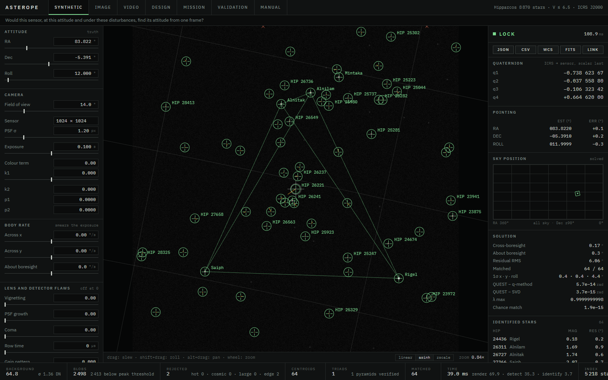
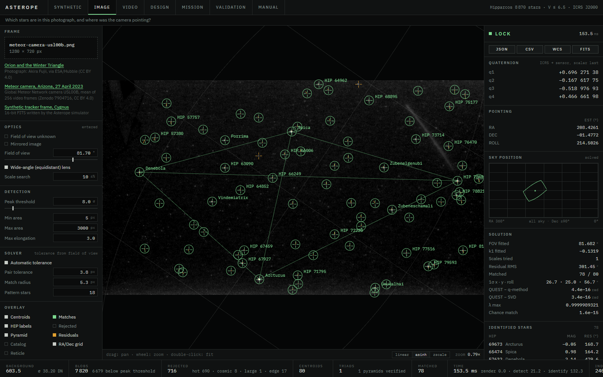

# Asterope

Asterope finds which way a camera is pointing by recognizing the stars in
its image. It is the software of a star tracker, the instrument a satellite
uses to know its orientation. This is its Python package: NumPy arrays in,
quaternions out.



- **Try it in a browser:** <https://spaceengineerss.github.io/asterope/>
- **Source, documentation and the record of what was measured:** <https://github.com/SpaceEngineerSS/asterope>

## Install

```
pip install asterope
```

Wheels for Linux (x86-64, ARM64), macOS (Intel, Apple silicon) and Windows,
Python 3.9 and later. The only dependency is NumPy.

## One frame

```python
import asterope

tracker = asterope.StarTracker(1024, 1024, fov_deg=14.0)
fix = tracker.solve(frame)            # frame: 2-D numpy array of uint16
if fix.locked:
    print(fix.ra_deg, fix.dec_deg, fix.roll_deg)
    print(fix.quaternion)             # (x, y, z, w), ICRS to sensor
    print([match.star for match in fix.matches])
```

No camera at hand? `asterope.simulate` renders the sky a sensor would see:

```python
frame = asterope.simulate(1024, 1024, 14.0, ra_deg=83.8, dec_deg=-5.4, roll_deg=12.0)
```

## What else it does

| | |
|---|---|
| `tracker.update(frame, dt)` | follows a sequence of frames, tracking from the last solution |
| `asterope.solve_image(frame)` | solves a photograph whose field of view is not known, and returns the lens it found |
| `tracker.enable_gyro(...)`, `gyro`, `update_aided` | joins a rate gyro to the star fixes and carries the attitude through frames without stars |
| `tracker.set_velocity(...)` | corrects for stellar aberration |
| `StarTracker.from_bytes(...)` | runs from the onboard catalog and index files a flight computer would carry |



## What has been measured

Every figure comes from a test in the repository;
[docs/validation.md](https://github.com/SpaceEngineerSS/asterope/blob/v0.1.0/docs/validation.md)
says which, how, where the solver breaks and what was not verified.

| | Result |
|---|---|
| 10 000 random attitudes with disturbances | 10 000 solved, no false lock; median error 0.53″ across the boresight |
| A million fields without a sky, a million with one | no attitude for the first; none over 0.1° off for the second |
| Real meteor cameras, 88° lens | 23 of 23 solved without a field of view |
| ESA star tracker test frames, against tetra3 | 8 of 8 agree, median difference 2.4″ |
| With a gyro, a third of the frames without stars | an attitude on 300 of 300 frames |

Nothing here has flown or run on hardware.

## Conventions

A frame is a C-contiguous `uint16` array, top row first. The quaternion
turns ICRS vectors into the sensor frame, scalar last, where +Z is the
boresight, +X image right and +Y image down. The built-in catalog holds the
Hipparcos stars to V 6.5; pass the bytes of another `.astc` file as
`catalog=` for a deeper one.

[docs/python.md](https://github.com/SpaceEngineerSS/asterope/blob/v0.1.0/docs/python.md)
describes every call.

## From source

```
pip install maturin
maturin build --release -m crates/asterope-py/Cargo.toml
pip install target/wheels/asterope-*.whl
pytest crates/asterope-py/tests
```

MIT or Apache-2.0, at your option.
